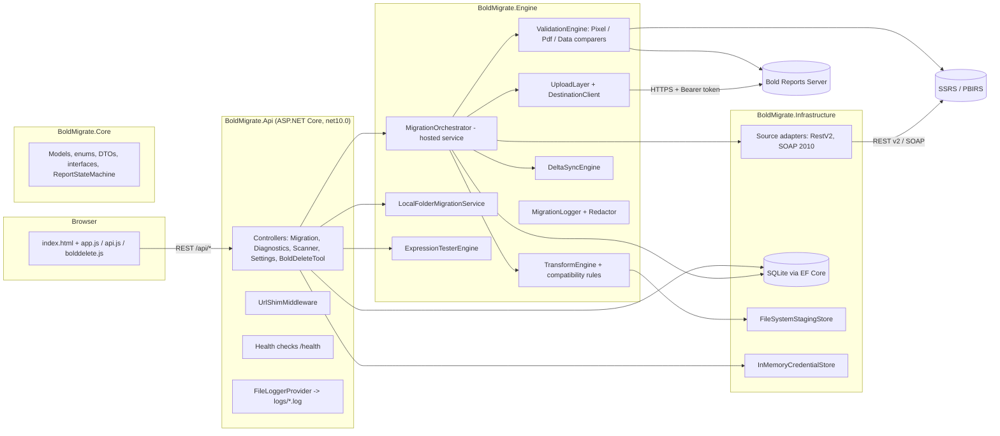
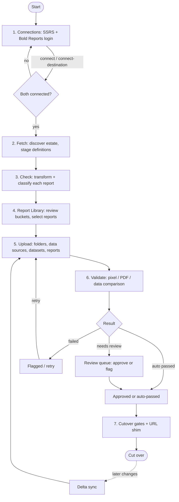
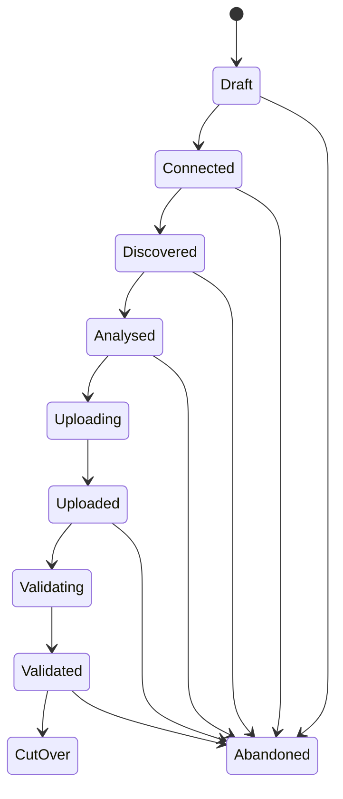
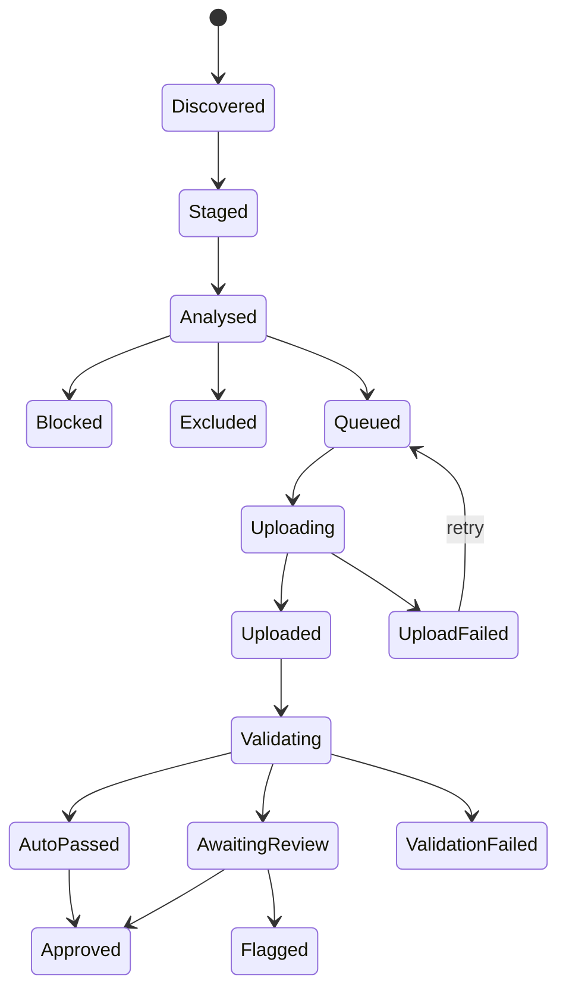

# Bold Migrate — Application Specification

Bold Migrate moves a SQL Server Reporting Services (SSRS) or Power BI Report Server estate to Bold Reports Server. It discovers the source estate, checks each report for compatibility, uploads items in dependency order, validates the result side by side, and supports a gated cutover. It also ships standalone tools for local-folder import, SSRS expression testing and bulk report deletion.

This document covers the whole application. The delete tool has its own detail spec: [bulk-delete-reports.md](bulk-delete-reports.md).

## 1. Goals and non-goals

**Goals**
- Migrate folders, data sources, datasets and reports from SSRS/PBIRS to Bold Reports with minimal manual work.
- Classify every report (clean, auto-fixed, needs review, blocked) before anything is uploaded.
- Prove the result with validation (visual, structural and data comparison) and a human approval step.
- Keep an audit trail: structured logs, event codes, a support bundle.

**Non-goals**
- Migrating report content that Bold Reports cannot run (custom assemblies and similar). These are flagged as blocked.
- Persisting passwords. Credentials are held in memory only (`InMemoryCredentialStore`).
- Multi-user concurrent operation. The app is a single-operator tool with one active run.

## 2. Architecture



| Project | Responsibility |
|---|---|
| `BoldMigrate.Api` | HTTP API, static UI (`wwwroot`), DI setup, URL shim middleware, health checks, file logging |
| `BoldMigrate.Engine` | Orchestration, transform/classification, upload, validation, delta sync, local folder import, expression tester, logging |
| `BoldMigrate.Infrastructure` | Source adapters (REST v2, SOAP), SQLite persistence, file staging, credential store |
| `BoldMigrate.Core` | Domain models, enums, DTOs, interfaces, report state machine, event codes and error catalogue |

Tests live in `tests/` (Core and Engine test projects).

## 3. End-to-end migration workflow



Stages in detail:

1. **Connect** — `POST /runs`, `/connect` (SSRS, REST v2 or SOAP 2010 adapter chosen via `SourceAdapterFactory`), `/connect-destination` (Bold Reports by credentials or pre-issued Bearer token). Credentials go to `InMemoryCredentialStore`.
2. **Fetch (discover)** — `/fetch` lists folders, data sources, datasets and reports into `CatalogItems` and stages RDL/RSDS/RSD files in the staging store.
3. **Check (transform)** — `/check` runs `TransformEngine` with rules loaded by `CompatibilityRulesLoader`. Each report gets a bucket (Clean, AutoFixed, NeedsReview, Blocked, Excluded) and a list of transform actions.
4. **Library** — the user filters the catalog and selects reports (`/select-reports`). Blocked and excluded reports are not uploaded.
5. **Upload** — `/upload` runs `UploadLayer` in four stages: Folders (categories), DataSources, DataSets, Reports. Uploads use an idempotency key per item, retry with attempts recorded, and treat a 409 as "already exists". The run can be paused/resumed in the UI and failed items retried (`/retry`).
6. **Validate** — `/validate` runs `ValidationEngine`: font calibration, pixel comparison, PDF structure comparison and data comparison. Results show side by side in the Validation tab. Reviewers approve or flag (`/approve`, `/flag`, `/bulk-approve`).
7. **Cutover** — `GET /cutover` evaluates the gates; `POST /cutover` completes it. `UrlShimMiddleware` maps old SSRS URLs to the Bold Reports URLs recorded in `UrlMapping`. A PDF report and a support bundle are downloadable from `DiagnosticsController`.

`/delta-sync` re-scans the source and uploads only items that changed. `/abandon` closes a run.

## 4. State models

### Run status (`RunStatus`)



### Report state (`ReportState`, enforced by `ReportStateMachine`)

States: Discovered, Staged, Analysed, Blocked, Queued, Uploading, Uploaded, UploadFailed, Validating, AutoPassed, AwaitingReview, ValidationFailed, Approved, Flagged, Excluded.



This diagram shows the intended main path. The authoritative transition table is in `ReportStateMachine.cs`.

## 5. Standalone tools

| Tool | UI | Backend | Purpose |
|---|---|---|---|
| Local Folder Import | sidebar "Local Folder Import" | `POST /api/migration/local-folder`, `GET .../local-folder/logs`, `LocalFolderMigrationService` | Upload `.rdl`, `.rsds`, `.rsd` from a local directory tree, creating nested categories, with backups and a log |
| AI Expression Tester | sidebar "AI Expression Tester" | `POST /api/migration/expression/evaluate`, `GET .../expression/samples`, `ExpressionTesterEngine` | Classify an SSRS expression as compatible / needs review / blocked and simulate it against sample fields and parameters |
| Bulk Delete Reports | sidebar "Bulk Delete Reports" | `POST /api/tools/bold-delete/list`, `POST .../delete`, `BoldDeleteToolController` | List and permanently delete reports on a Bold Reports server, no run needed. See [bulk-delete-reports.md](bulk-delete-reports.md) |
| RDL scanner | landing page drop zone | `POST /api/scanner/analyse` | Scan dropped RDL files in the browser flow for compatibility |
| Settings & Rules | sidebar "Settings & Rules" | `GET/PUT /api/settings` | Thresholds, URL shim and other options |

The Report Library also has a run-based delete (`POST /runs/{id}/destination/delete-reports`) that only removes reports of the current run and resets their local state.

## 6. API reference

Base path `/api`. All bodies are JSON.

**Migration** (`/api/migration`)

| Method | Route | Purpose |
|---|---|---|
| POST | `/runs` | Create or get the active run |
| GET | `/runs/{id}`, `/active-run` | Run details |
| POST | `/runs/{id}/connect` | Test and save SSRS connection |
| POST | `/runs/{id}/connect-destination` | Test and save Bold Reports connection |
| POST | `/runs/{id}/fetch` | Discover the source estate |
| POST | `/runs/{id}/check` | Transform and classify |
| POST | `/runs/{id}/upload` | Four-stage upload |
| POST | `/runs/{id}/validate` | Validation pass |
| POST | `/runs/{id}/retry`, `/abandon` | Retry failures, close the run |
| GET | `/runs/{id}/estate`, `/datasources`, `/reports` | Catalog views |
| POST | `/runs/{id}/select-reports` | Choose reports to migrate |
| GET | `/runs/{id}/reports/{reportId}/rdl`, `/validation` | RDL diff, validation result |
| GET | `/runs/{id}/review-queue` | Reports awaiting review |
| POST | `/runs/{id}/reports/{reportId}/approve`, `/flag`; `/runs/{id}/reports/bulk-approve` | Review actions |
| POST | `/runs/{id}/delta-sync` | Incremental sync |
| GET / POST | `/runs/{id}/cutover` | Gate status / perform cutover |
| GET | `/runs/{id}/log`, `/runs/{id}/poll` | Log lines, progress polling |
| GET | `/runs/{id}/designer-config` | Config for the embedded Bold Report Designer |
| GET | `/runs/{id}/destination/sections` | Destination folders/categories |
| POST | `/runs/{id}/destination/delete-reports` | Run-based delete |
| POST / GET | `/local-folder`, `/local-folder/logs` | Local folder import |
| POST / GET | `/expression/evaluate`, `/expression/samples` | Expression tester |

**Other controllers**: `GET /api/diagnostics/runs/{id}/support-bundle`, `GET /api/diagnostics/runs/{id}/report-pdf`, `POST /api/scanner/analyse`, `GET|PUT /api/settings`, `POST /api/tools/bold-delete/list|delete`, and `GET /health`.

## 7. Data model

Stored in SQLite (`MigrationDbContext`, EF Core). Main entities:

- `MigrationRun` — one migration session: source and destination URLs, status, settings.
- `CatalogItem` — a discovered folder, data source, dataset or report (source path, hash, staged file path, destination item id).
- `ReportRecord` — per-report state, bucket, parameter count, data source and dataset references, idempotency key, upload attempts.
- `TransformAction`, `UploadAttempt`, `ValidationResult`, `Approval`, `AuditEvent` — what was changed, what was tried, what was compared, who approved, what happened.
- `UrlMapping`, `PermissionMapping`, `SubscriptionRecord` — URL redirects, mapped permissions, discovered subscriptions.

Staged source files live on disk under the staging root. Credentials are never written to the database.

## 8. Configuration

- `MigrationSettings` (bound at startup in `Program.cs`) holds the database path, staging root path, thresholds and URL shim options. The Settings tab edits them through `/api/settings`.
- Compatibility rules are loaded by `CompatibilityRulesLoader`.
- `Configuration.json` drives the separate PowerShell/batch migration script (`SSRSToBoldReportsMigration.ps1/.bat`), which is independent of the web app.
- Default dev URL: `http://localhost:5000`. Override with `--urls`.

## 9. Security

- Passwords and tokens are held in memory only and are redacted from logs by `Redactor`.
- The Bold Reports token is sent as a Bearer header over the configured URL. Use https outside local testing.
- Destructive operations (delete tools) require explicit selection and a confirmation dialog in the UI. The delete tool re-authenticates on each request and stores nothing.
- The app has no login of its own. Run it on a trusted machine or behind network controls; do not expose it publicly.

## 10. Logging and diagnostics

- **File logs**: `FileLoggerProvider` writes text logs under `logs/` (ignored by git).
- **Run logs**: `MigrationLogger` records per-run events with codes from `EventCodes` and messages from `ErrorCatalogue`; shown in the Migration tab and `GET /runs/{id}/log`.
- **Support bundle**: ZIP of logs, state and results for a run (`/api/diagnostics/runs/{id}/support-bundle`).
- **Health**: `GET /health` (`MigrationHealthChecks`).
- **Metrics**: `MigrationMetrics`.

## 11. Running and testing

```powershell
dotnet run --project src/BoldMigrate.Api/BoldMigrate.Api.csproj --urls http://localhost:5268
dotnet test
```

Docker files (`Dockerfile`, `docker-compose.yml`) exist for containerised runs. Use them only after the local run works.

## 12. Known limitations

- Single operator, one active run at a time.
- Credentials are lost when the app restarts and must be re-entered.
- Bold Reports API paths vary by version, so `DestinationClient` tries several URL patterns per call. This is robust but can hide the real failure reason.
- The delete tools give no per-item failure reason.
- Docs describe the code as built; validation thresholds and the full state transition table should be read from `ValidationEngine` and `ReportStateMachine` when they matter.
