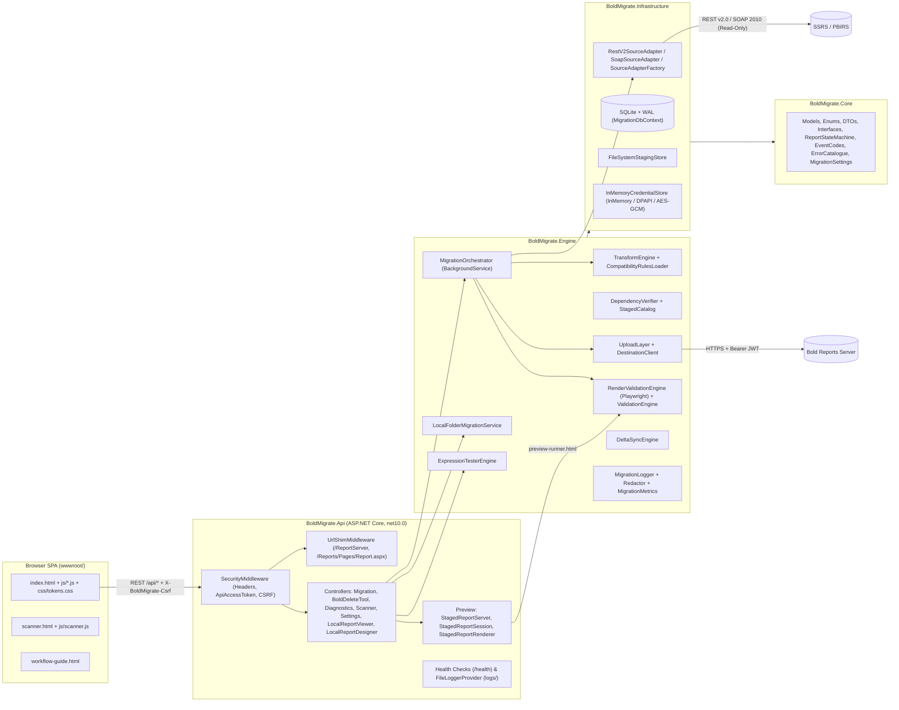
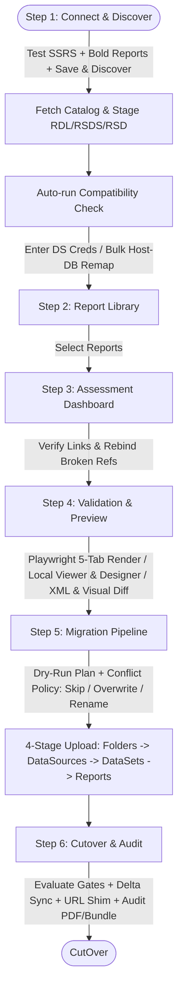
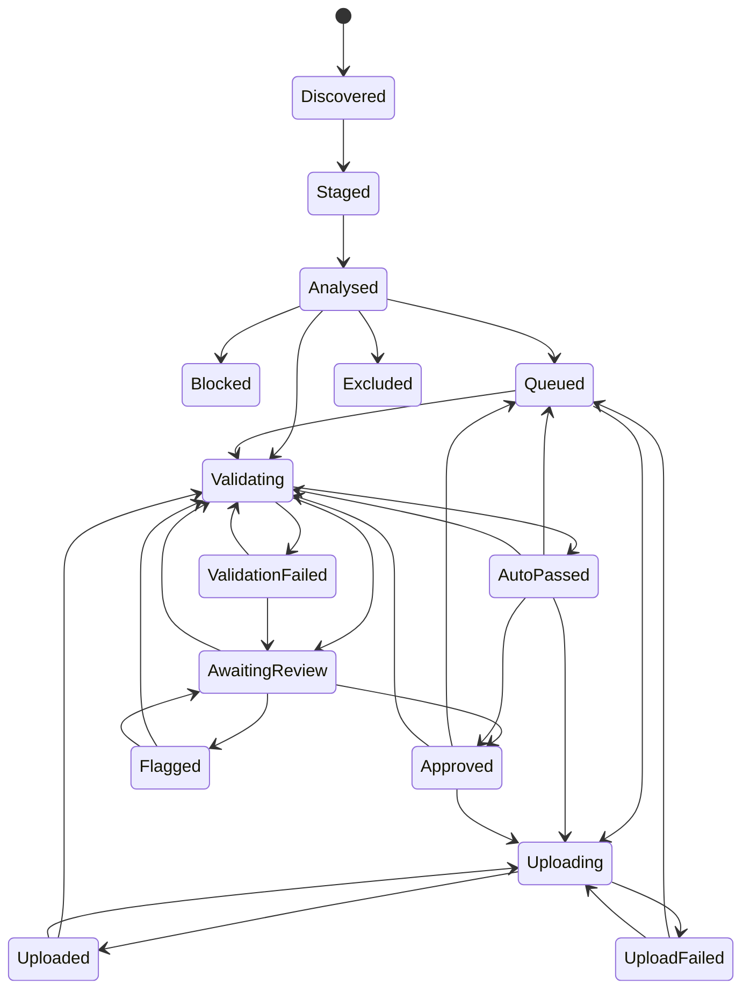

# Bold Migrate — Application & System Specification

**Status:** Implemented (Authoritative System Specification)  
**Target Runtime:** .NET 10 (`net10.0`), ASP.NET Core, SQLite (EF Core), Playwright Chromium, Bold Reports `15.1.17`

Bold Migrate is a standalone enterprise migration service that moves SQL Server Reporting Services (SSRS 2012–2022) and Power BI Report Server (PBIRS) estates—or offline local report folders—to Bold Reports Server. It discovers and stages the source estate read-only, transforms and classifies `.rdl` definitions against runtime-loaded compatibility rules, validates reports locally via headless Playwright and embedded Bold Reports Viewer/Designer before upload, executes a dependency-ordered 4-stage upload pipeline with conflict policies and dry-run planning, and supports gated production cutover with delta sync and a transparent SSRS URL compatibility shim.

---

## 1. Goals and Non-Goals

### Goals
- **Read-only source extraction:** Connect to SSRS/PBIRS via REST API v2.0 or SOAP `ReportingService2010` (`ISourceCatalog`) without issuing write operations to the source server.
- **Pre-upload transformation & classification:** Strip BOMs, upgrade RDL schemas (`2008`/`2010` -> `2016`), rebind references, extract feature tags, and classify reports into `Clean`, `AutoFixed`, `NeedsReview`, `Blocked`, or `Excluded` using `data/compatibility-rules.json`.
- **Pre-upload local preview, editing & validation:** Render staged reports locally using `StagedReportServer` (`BoldReports.AspNet.Core` / `BoldReports.Net.Core` `15.1.17`) and headless Playwright Chromium (`RenderValidationEngine`), allow visual swipe/side-by-side/pixel-diff and XML diff inspection, and support in-browser editing via the embedded Web Report Designer saving back to staging.
- **Deterministic 4-stage upload:** Provision Categories (nested folder tree), Data Sources, Shared Data Sets, and Reports in strict dependency order with per-item idempotency keys, configurable conflict policies (`Skip`, `Overwrite`, `Rename`), pre-flight dry-run preview, pause/resume, and retry.
- **Gated cutover & backward-compatible URLs:** Enforce readiness gates, support incremental delta sync, generate audit reports and diagnostic support bundles, and redirect legacy `/ReportServer` and `/Reports/Pages/Report.aspx` URLs via `UrlShimMiddleware`.
- **Standalone operational tools:** Provide Local Folder Import (`.rdl`, `.rsds`/`.rds`, `.rsd`), Multi-Type Bulk Delete (Reports, Datasets, Data Sources, Folders), Offline Compatibility Scanner (`scanner.html` + `/api/scanner/analyse`), Settings & Rules management, and an SSRS Expression Tester API.

### Non-Goals
- **Unsupported SSRS artifacts:** Mobile reports (`.rsmobile`), Power BI `.pbix` reports, semantic models (`.smdl`), report snapshots/execution history, and custom SSRS security extensions are not migrated.
- **Unencrypted credential persistence:** Database passwords, SSRS passwords, and Bold Reports Bearer tokens are never written to SQLite or log files.
- **Multi-user concurrent sessions:** Designed as a single-operator console managing one active migration run at a time (previous active runs are abandoned when starting a fresh run).

---

## 2. System Architecture

Bold Migrate is structured as a four-project .NET 10 solution (`BoldMigrate.slnx`) plus three automated test projects:

### Project Responsibilities

| Project | Path | Responsibility |
|---|---|---|
| `BoldMigrate.Core` | `src/BoldMigrate.Core/` | Domain models, enums, DTOs, repository/adapter interfaces, `ReportStateMachine`, `MigrationSettings`, `EventCodes`, `ErrorCatalogue`, `HostResolver`, `SqlConnectionHelper`. Zero external NuGet dependencies. |
| `BoldMigrate.Infrastructure` | `src/BoldMigrate.Infrastructure/` | EF Core SQLite persistence (`MigrationDbContext`, `MigrationStoreRepository`), SSRS adapters (`RestV2SourceAdapter`, `SoapSourceAdapter`, `SourceAdapterFactory`), local staging (`FileSystemStagingStore`), credential vault (`InMemoryCredentialStore`). |
| `BoldMigrate.Engine` | `src/BoldMigrate.Engine/` | `MigrationOrchestrator` (`BackgroundService`), `TransformEngine`, `CompatibilityRulesLoader`, `DependencyVerifier`, `StagedCatalog`, `UploadLayer`, `DestinationClient`, `RenderValidationEngine` (Playwright), `ValidationEngine`, `DeltaSyncEngine`, `LocalFolderMigrationService`, `ExpressionTesterEngine`, `MigrationLogger`, `Redactor`, `MigrationMetrics`. |
| `BoldMigrate.Api` | `src/BoldMigrate.Api/` | ASP.NET Core host (`Program.cs`), REST controllers, `SecurityMiddleware`, `UrlShimMiddleware`, `StagedReportServer` / `StagedReportSession` / `StagedReportRenderer`, `MigrationHealthChecks`, `FileLoggerProvider`, and static SPA in `wwwroot/`. |
| Tests | `tests/BoldMigrate.*.Tests/` | xUnit unit tests (`Core.Tests`, `Engine.Tests`) and `WebApplicationFactory<Program>` integration tests (`Api.Tests`). |

---

## 3. End-to-End 6-Step Migration Journey

The primary console (`src/BoldMigrate.Api/wwwroot/index.html`) guides operators through a 6-step sequential journey alongside a persistent sidebar and global activity progress bar:

### Step 1 — Connect & Discover (`connections.js`)
1. **Run Initialization:** On load, `initApp()` calls `GET /api/migration/active-run` (resuming an existing non-abandoned run if present, or creating one via `POST /api/migration/runs`). **New Migration Run** (`ForceNew = true`) abandons the active run and creates a fresh run.
2. **Source SSRS Server:** Supports `Integrated` (current Windows session SSPI/NTLM), `WindowsExplicit` (`Domain\User` or `user@domain`), and `Basic` (HTTPS-only; plain HTTP non-loopback is rejected with `SRC-007`). `SourceAdapterFactory` probes REST v2.0 (`/api/v2.0/$metadata`) and falls back to SOAP 2010 (`/ReportService2010.asmx?wsdl`), or honors `Extraction.PreferredApi`. If explicit credentials return 401, the API probes Windows Integrated auth and returns an actionable hint if Integrated succeeds.
3. **Destination Bold Reports Server:** Authenticates via admin email/password (`POST .../token` across candidate Bold Reports tenant paths) or direct Bearer JWT token (`POST /api/migration/runs/{id}/connect-destination`).
4. **Catalog Discovery & Staging:** **Save & Discover Catalog** triggers `POST .../fetch` (parallel download up to `Extraction.MaxParallel`, storing unmodified copies in `__originals/` and BOM-stripped working copies in staging) followed by `POST .../check` (`TransformEngine`). Re-scanning an already-populated run opens a confirmation modal, abandons the old run, and starts fresh.
5. **Discovered Data Source Credentials & Bulk Remapping:**
   - Displays all staged `.rsds`/`.rds` data sources with redacted connection strings (`Redactor.RedactConnectionString`).
   - Supports credential modes `Integrated`, `Store`, `Prompt`, and `None`, live SQL Server connectivity testing (`POST .../datasources/{dataSourceId}/validate-and-save`), and optional `TrustServerCertificate` override (`Preview.AllowUntrustedSqlCert`, detecting SQL Error `-2146893019`).
   - **Bulk Host / Database Remapping** (`POST .../datasources/bulk-remap`) supports `DryRun` preview and batch updates across staged `.rsds` files for server host, database/initial catalog, credential mode, username/password, and TLS trust.
   - **Credential Storage Mode** (`PUT .../credential-mode`) toggles between `InMemory` (default volatile) and `DpapiLocal` (DPAPI on Windows / AES-GCM key file on Linux). `ExternalVault` is rejected as unconfigured.

### Step 2 — Report Library (`library.js`)
- Displays discovered reports (`GET .../reports`) with search, compatibility filter chips (`All`, `Compatible`, `Needs Review`), parameter counts, feature tags, and block/review findings.
- Operators select/deselect reports (`POST .../select-reports`, which toggles non-blocked reports between `Analysed` and `Excluded`), launch **Inspect & Validate** directly into the local Staged Report Viewer, or delete reports from Bold Reports (`POST .../destination/delete-reports`).

### Step 3 — Assessment Dashboard (`library.js`)
- Summarizes estate readiness (`(Clean + AutoFixed) / Total`), compatibility breakdown bars, connection pills, and items tagged for review.
- **Link Verification (`DependencyVerifier`):** `GET .../dependencies/verify` audits every staged report's `DataSourceReference`, `SharedDataSetReference` (including chained dataset-to-datasource links), and `Subreport/ReportName` references, detecting missing targets and circular subreport cycles. Broken links can be rebound directly in staged RDL XML via `POST .../reports/{reportId}/rebind-reference`.

### Step 4 — Automated Render Validation & Preview (`validation.js`, `modals.js`)
- **Headless Playwright Render Validation (`RenderValidationEngine`):** `POST .../validate-render?concurrency=5` launches headless Chromium against `preview-runner.html` (backed by `LocalReportViewerController` and `StagedReportServer`) for all or selected reports.
  - Reports with prompt parameters lacking defaults/valid values and non-nullable are classified `NeedsManualCheck` (`AwaitingReview`).
  - Successful renders capture a `1280x900` PNG screenshot (`GET .../screenshots/{reportId}.png`) and mark reports `Passed` (`Approved`).
  - SQL connection/login/TLS errors during local preview are classified `DataSourceOffline` (`Approved` — RDL structure valid, ready for server upload).
  - Other render/timeout failures are classified `Failed` (`ValidationFailed`) with captured `IRenderLogStore` diagnostics (`GET /api/preview/runs/{runId}/viewer/render-logs`).
- **Interactive Inspection Tools:**
  - **Local Staged Viewer & Designer:** Opens staged reports in Bold Reports Viewer/Designer (`15.1.17`) without touching the destination server. Saving in the designer writes back to staging via `StagedReportSession.SaveReportAsync` and sets `LocalEditUtc` and `LocalEditPendingUpload = true`.
  - **XML Diff Modal (`GET .../rdl`):** Side-by-side comparison of `__originals/` source RDL vs. transformed/staged RDL, with **Approve** (`POST .../approve`) and **Flag for Designer** (`POST .../flag`) actions.
  - **Visual Comparison Modal:** Swipe slider, side-by-side, and client-side Canvas Pixel-Diff (configurable channel tolerance `0–50`) comparing the local Playwright screenshot against either the live SSRS PNG render (`GET .../screenshots/{reportId}/source.png`) or a user-uploaded Reference PNG.
  - **Bulk Approve Queue (`POST .../reports/bulk-approve`):** Approves `AwaitingReview` reports sequentially and stops at the first report below `minAccuracy` (default `99.0%`).
  - **Skip Validation (`POST .../skip-validation`):** Marks non-blocked reports `AutoPassed` with `Skipped` status so operators can proceed directly to upload.

### Step 5 — Batch Migration Pipeline (`migration.js`)
- **Conflict Resolution & Dry-Run:** Operators choose `Skip` (default), `Overwrite`, or `Rename` (`_migrated` suffix) and can run `POST .../upload/dry-run` (`UploadLayer.PreviewUploadPlanAsync`) to preview planned `Create`, `Skip`, `Overwrite`, `Rename`, and `Blocked` actions against the live destination server before uploading.
- **4-Stage Dependency Upload (`UploadLayer.UploadEstateAsync`):**
  1. **Folders (`Category`):** Sequential, shallowest-to-deepest parent-before-child creation via `/v5.0/categories` (or `/v1.0/categories`).
  2. **Data Sources (`Datasource`):** Parallel (`Upload.MaxParallel`) creation/update via `/v1.0/reports/data-sources`, applying credentials from `ICredentialStore` or `.rsds` XML.
  3. **Shared Datasets (`Dataset`):** Parallel upload of `.rsd` base64 payloads via `/v1.0/reports/datasets`, remapped to target data source names.
  4. **Reports (`Report`):** Parallel upload via `/v1.0/reports` (or `/v5.0/reports`). **Upload gating:** only reports in `AutoPassed`, `Approved`, `Queued`, or `Uploaded` (with `LocalEditPendingUpload == true`) are uploaded; `Blocked`, `Excluded`, or unvalidated reports are skipped (`UPLD-GATE-SKIP`).
- **Pause, Resume & Retry:** Pause checks `_pausedRuns` between items (`POST .../upload?action=pause|resume`). `POST .../retry` transitions `UploadFailed` reports back to `Queued` and re-runs upload.
- **Server-Integrated Actions:** Uploaded reports can be viewed or edited directly on the destination Bold Reports Server from the Step 5 table.

### Step 6 — Production Cutover & Audit (`migration.js`, `DiagnosticsController`)
- **Readiness Gates (`GET .../cutover`):** Evaluates five blocking gates and one advisory gate (`URL compatibility shim configured`):
  1. Reports uploaded to destination (`actuallyUploaded > 0`).
  2. Every uploaded report validated against destination (measured `ValidationResult` exists).
  3. No reports awaiting manual review (`AwaitingReview == 0`).
  4. No failed uploads or validations (`UploadFailed == 0 && ValidationFailed == 0`).
  5. No selected reports left unprocessed (`Discovered`/`Analysed`/`Queued == 0`).
  6. *(Advisory)* URL compatibility shim configured (`UrlShim.Enabled`).
- **Delta Sync (`POST .../delta-sync`):** Re-enumerates SSRS items, compares `ModifiedUtc` and SHA-256 hashes, preserves locally edited Step 4 reports (`CUT-DELTA-EDIT`), re-stages/re-transforms/re-validates changed reports, and counts source deletions.
- **URL Compatibility Shim (`UrlShimMiddleware`):** When `UrlShim.Enabled` is `true`, intercepts `/ReportServer` (or configured `UrlShim.ListenPath`) and `/Reports/Pages/Report.aspx?ItemPath=...` requests, looks up `UrlMapping` across non-abandoned runs, validates redirect safety (`IsSafeRedirectDestination`), forwards `rs:Format` as `exportFormat` and report parameters, and returns a styled HTML 404 diagnostic page for unmapped paths.
- **Confirm Cutover (`POST .../cutover`):** Requires at least one uploaded report, sets `RunStatus.CutOver`, deletes staging and `_designer-cache` if `Staging.DeleteOnClose` is `true`, clears `ICredentialStore`, and logs `RUN-COMPLETE`.
- **Audit & Diagnostics:** Exports plain-text Migration Run Report (`GET /api/diagnostics/runs/{id}/report-pdf` -> `migration-report-{id}.txt`) and ZIP Support Bundle (`GET /api/diagnostics/runs/{id}/support-bundle` containing `run.json`, `reports.json`, `audit-events.json`).

---

## 4. State Models

### `RunStatus`
`Draft` → `Connected` → `Discovered` → `Analysed` → (`Validating` ↔ `Validated`) → `Uploading` → `Uploaded` → `CutOver` (or `Abandoned` from any active state).  
On process startup, `MigrationOrchestrator.ExecuteAsync` recovers active runs stuck in transient `Uploading` (resets to `Validated`) or `Validating` (resets to `Analysed`) and logs `RUN-RESUME`.

### `ReportState` (`ReportStateMachine`)
Legal transitions enforced by `BoldMigrate.Core.StateMachine.ReportStateMachine`:

*(Any state other than `Excluded` may also transition to `Excluded` with an optional `ExcludedReason`.)*

---

## 5. Transform, Compatibility & Data Model

### RDL Rewrite Actions (`TransformEngine`)
All XML processing uses `System.Xml.Linq` and `XmlReader` with `DtdProcessing.Prohibit` (never regex):
- `TR-STRIP-BOM`: Strips leading UTF-8 BOM (`0xEF 0xBB 0xBF`).
- `TR-REBIND-DS`: Rebinds `DataSourceReference` using discovered data source map.
- `TR-MAP-DSET`: Maps `DataSetReference` using discovered dataset map.
- `TR-PATH-SUB`: Strips leading `/` on `Subreport/ReportName` paths.
- `TR-PATH-DRILL`: Strips leading `/` on `Drillthrough/ReportName` paths.
- `TR-SCHEMA-UP`: Upgrades RDL `2008/01` or `2010/01` root/descendant namespaces to `2016/01/reportdefinition`.

### Compatibility Rules (`data/compatibility-rules.json`)
Loaded and cached by `CompatibilityRulesLoader` (refresh interval `Transform.RulesRefreshHours`). Every rule **must** specify a non-empty `article` KB URL or loading throws `InvalidOperationException`. Current bundled rules (`version: "2026.11.1"`):
- `NeedsReview`: `CF-ASSEMBLY` (`CodeModule`), `CF-UNSUPPORTED-TYPE`
- `Clean` (tagged as informational `FeatureTags`): `CF-CODE-NET`, `CF-CODE-SIMPLE`, `CF-SUBREPORT`, `CF-LOOKUP`, `CF-MAP`, `CF-GAUGE`, `CF-INTERACTIVE-SORT`, `CF-RICHTEXT`, `CF-SHARED-DSET`, `CF-SHARED-DS`, `CF-DOCMAP` (plus `Chart` detection).

### Persistence (`MigrationDbContext` — SQLite WAL)
Tables: `MigrationRuns`, `CatalogItems`, `ReportRecords`, `TransformActions`, `UploadAttempts`, `ValidationResults`, `Approvals`, `PermissionMappings`, `SubscriptionRecords`, `UrlMappings`, `AuditEvents`.  
`Program.cs` executes `EnsureCreated()`, enables `PRAGMA journal_mode=WAL; PRAGMA busy_timeout=5000;`, deduplicates legacy `CatalogItems`, and applies idempotent `ALTER TABLE` / table rebuild migrations at startup.

---

## 6. Standalone Tools

| Tool | UI Entry | Backend | Behavior |
|---|---|---|---|
| **Local Folder Import** | Sidebar: `Local Folder Import` | `POST /api/migration/local-folder`, `GET .../local-folder/logs` | Backs up `.rdl` files, uploads `.rsds`/`.rds` data sources, `.rsd` datasets, and `.rdl` reports with nested category creation, BOM stripping, `UnsafeRelaxedJsonEscaping`, and generates `MigrationLog.txt`, phase logs, `MigrationResult.csv`, `inventory.csv`, `item-results.json`, and `migration-summary.md`. |
| **Bulk Delete Items** | Sidebar: `Bulk Delete Reports` | `POST /api/tools/bold-delete/list`, `POST .../delete` | Connects per-request (no run or stored creds), lists and filters `Report`, `Dataset`, `Datasource`, and `Folder` (`Category`) items, and deletes selected items in safe dependency order (`Report -> Dataset -> Datasource -> Folder`). |
| **Offline RDL Scanner** | `/scanner.html` + Landing dropzone | Client-side `scanner.js` + `POST /api/scanner/analyse` | `scanner.html` parses `.rdl` files purely in-browser via `DOMParser`; landing dropzone submits `.rdl`/`.rdlc`/`.xml` (max 25 MB) to `ScannerController`. |
| **Settings & Rules** | Sidebar: `Settings & Rules` | `GET/PUT /api/settings`, `GET /api/settings/rules` | Edits validated `MigrationSettings` persisted to `settings.json` in the data directory and inspects loaded compatibility rules. |
| **Expression Tester API** | API only | `POST /api/migration/expression/evaluate`, `GET .../samples` | Evaluates SSRS expressions (`IIf`, `Switch`, `Format`, `Sum`, `UCase`/`LCase`, `Lookup`, `System.*`, `Code.*`) with compatibility status and mock evaluation. |

---

## 7. Security, Observability & Configuration

- **SecurityMiddleware:** Sets `X-Content-Type-Options: nosniff`, `X-Frame-Options: SAMEORIGIN`, `Referrer-Policy: no-referrer`, `Permissions-Policy`. Enforces optional `BoldMigrate:ApiAccessToken` (`Bearer`, `X-Api-Key`, or `access_token` query) via constant-time comparison, and enforces double-submit CSRF (`bm_csrf` cookie + `X-BoldMigrate-Csrf` header) on browser mutating `/api/*` requests (exempting Bold Reports viewer/designer internal callbacks while validating same-origin `Origin`/`Sec-Fetch-Site`).
- **Path & Redirect Safety:** `FileSystemStagingStore` and `LocalReportDesignerController` reject `..` traversal and enforce prefix boundaries; `LocalFolderMigrationService` enforces `AllowedLocalFolderRoots` when configured; `UrlShimMiddleware` restricts redirects to safe relative paths or the configured `DestinationServerUrl` origin.
- **Secret Redaction:** `Redactor.RedactSecrets` scrubs connection string passwords/UIDs/keys, Bearer tokens, `Authorization` headers, JSON secret fields, and `<PassWord>` XML nodes before writing to `FileLoggerProvider` (`logs/boldmigrate-yyyyMMdd.log`) or `MigrationLogger`.
- **Health & Metrics:** `GET /health` reports `Healthy` or `Degraded` across orchestrator heartbeat, SQLite store, staging disk space, and rules loader (never `Unhealthy`). OpenTelemetry-compatible `System.Diagnostics.Metrics` counters/histograms are emitted under meter `BoldMigrate`.
