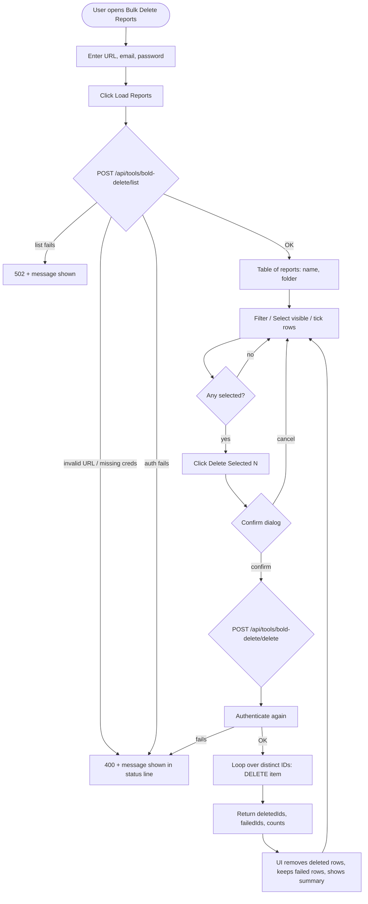
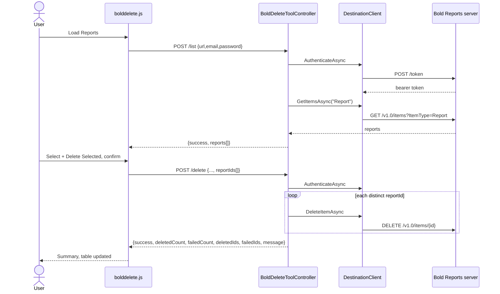

# Bulk Delete Reports — Specification

Standalone tool in Bold-Migrate (sidebar → STANDALONE TOOLS → **Bulk Delete Reports**) that lists the reports on a Bold Reports server and permanently deletes the ones the user selects. It does not need a migration run.

## 1. Goals and non-goals

**Goals**
- Connect to any Bold Reports server with URL, email and password.
- List all reports with name and folder (category), filter them, and select several.
- Delete the selected reports and report exactly what succeeded and what failed.

**Non-goals**
- Deleting category folders, data sources or datasets.
- Storing credentials (they are used for one request only).
- Undo or recycle bin. Deletes are permanent.
- Touching migration-run data. The run-based delete in the Report Library is a separate feature.

## 2. Workflow

### Sequence

## 3. API

Base path: `/api/tools/bold-delete`. All bodies are JSON.

### POST `/list`
Request: `{ "url": "https://reports.example.com", "email": "...", "password": "..." }`

| Status | Body |
|---|---|
| 200 | `{ success: true, reports: [{ id, name, category }] }` sorted by category, then name |
| 400 | `{ success: false, message }` for an invalid URL, missing email/password or failed authentication |
| 502 | `{ success: false, message }` when the server could not be queried |

### POST `/delete`
Request: the same fields plus `"reportIds": ["<id>", ...]`

| Status | Body |
|---|---|
| 200 | `{ success, deletedCount, failedCount, deletedIds[], failedIds[], message }`. `success` is true only when `failedCount` is 0. |
| 400 | `{ success: false, message }` for no IDs selected, or the same validation and authentication errors as `/list` |

Rules
- URL must be absolute `http` or `https`.
- Duplicate IDs are removed. Each ID is deleted independently, so one failure does not stop the rest.
- Counts come only from deletes the server accepted. A 404 from the server counts as deleted, because the report is already gone.

## 4. UI behaviour

- Fields: URL, email, password (`autocomplete="new-password"`), **Load Reports**.
- Table: checkbox, name, folder. Filter box matches name or folder (case-insensitive).
- **Select visible** and **Clear** act on the filtered rows only.
- The button shows **Delete Selected (N)** and is disabled when N is 0.
- A confirmation dialog appears before deleting. After the call, deleted rows are removed, failed rows stay selected-able, and the status line shows the summary message.

## 5. Security and logging

- Credentials are sent over the request body, used to obtain a token for that call, and never stored or logged. Use https for non-local servers.
- Only a summary line is logged: `[BOLD-DELETE] Deleted {n} report(s), {m} failed on {url}`, in `logs/boldmigrate-yyyyMMdd.log`. Per-report exceptions are logged as warnings with the report ID.
- The tool has no login of its own. Anyone who can reach the Bold-Migrate site and holds Bold Reports credentials can use it, so keep the app on a trusted network.

## 6. Files

| File | Role |
|---|---|
| `src/BoldMigrate.Api/Controllers/BoldDeleteToolController.cs` | `/list` and `/delete` endpoints |
| `src/BoldMigrate.Api/wwwroot/js/bolddelete.js` | UI logic |
| `src/BoldMigrate.Api/wwwroot/index.html` | sidebar item `nav-bold-delete` and panel `tab-bold-delete` |
| `src/BoldMigrate.Engine/Upload/UploadLayer.cs` | `DestinationClient.GetItemsAsync` / `DeleteItemAsync` (reused) |

## 7. Known limits and open items

- `DeleteItemAsync` tries several URL variants and returns false if none succeed, so the reason for a failure is not reported per report.
- No automated tests yet for the two endpoints. They need a stubbed `DestinationClient` or HTTP handler.
- Not yet verified against a live Bold Reports server.
- Possible follow-ups: delete empty folders, export the list before deleting, a "type DELETE to confirm" step for large selections.
